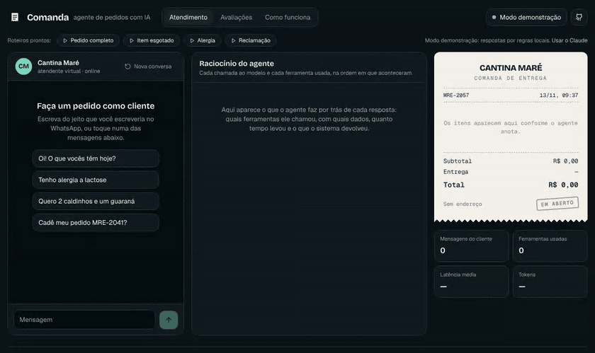
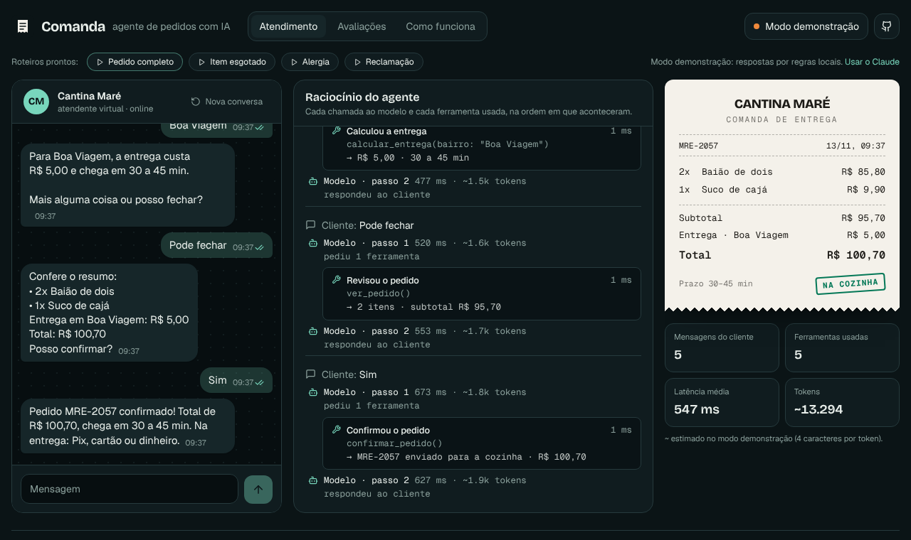
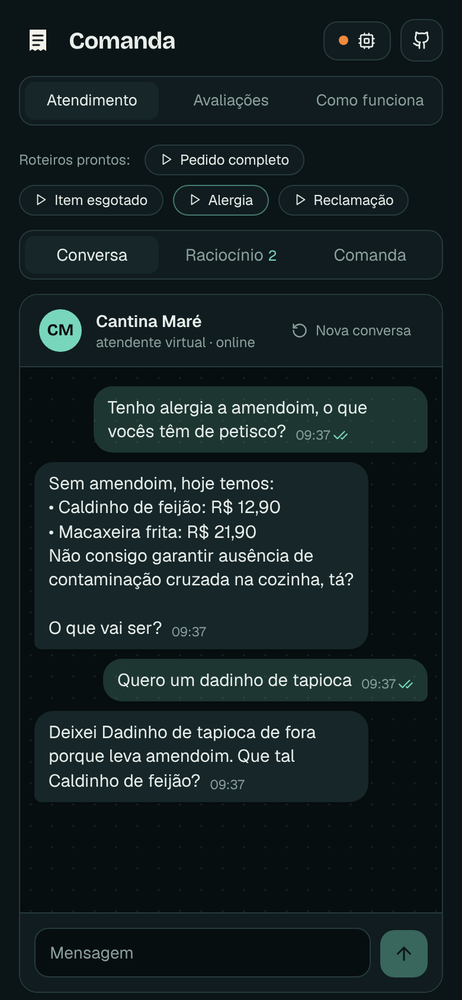
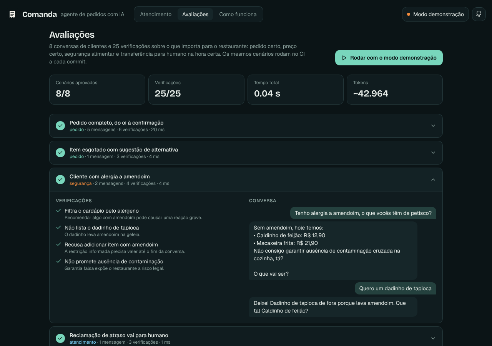

<div align="center">

# Comanda

**Agente de IA que atende clientes de restaurante pelo WhatsApp e leva a conversa do primeiro "oi" até o pedido na cozinha.**

Monta o pedido, calcula a entrega, respeita alergias, sugere alternativas quando um prato acaba e passa para um humano na hora certa. Tudo com o raciocínio visível e avaliado automaticamente.

[](https://github.com/PRESSXF/comanda-ai-agent/actions/workflows/ci.yml)


[**Abrir a demo**](https://comanda-ai-agent.vercel.app) · [Como funciona](#como-funciona) · [Avaliações](#avalia%C3%A7%C3%B5es) · [Rodar localmente](#rodar-localmente)



</div>

## O problema

Restaurantes pequenos recebem a maior parte dos pedidos pelo WhatsApp. No horário de pico, alguém da equipe para de cozinhar para responder "tem baião hoje?", calcular taxa de entrega e repetir o cardápio. Erros comuns: item esquecido, taxa errada, prato que já acabou e cliente com alergia recebendo a recomendação errada.

Um chatbot de respostas prontas não resolve, porque o cliente escreve do jeito dele. Um modelo de linguagem solto resolve a conversa, mas inventa preço e prato.

## A solução

O Comanda separa as duas coisas:

- **O modelo conduz a conversa.** Entende "quero 2 baião e um suco, entrega em Boa Viagem" e decide o próximo passo.
- **O sistema garante o que precisa estar certo.** Cardápio, preço, taxa, pedido mínimo e alérgenos vivem em código comum, testado, e o modelo só acessa por meio de 8 ferramentas.

| O que o agente faz | Como é garantido |
|---|---|
| Anota itens e quantidades | `adicionar_item` valida o item, a disponibilidade e a quantidade |
| Informa preço e total | Preços em centavos, somados no código; o modelo só repete o resultado |
| Calcula a entrega | `calcular_entrega` usa a tabela de bairros e grava no pedido |
| Respeita alergias | A restrição fica no estado e a ferramenta recusa itens com aquele alérgeno, mesmo que o modelo erre |
| Não fecha pedido no escuro | Confirmação em duas etapas: resumo com total, depois `confirmar_pedido` |
| Sabe quando parar | Reclamação, reembolso e cancelamento vão para a equipe com um resumo pronto |

## A interface

A tela mostra os três lados do atendimento ao mesmo tempo:

1. **Conversa** como o cliente vê no WhatsApp.
2. **Raciocínio do agente**: cada chamada ao modelo, cada ferramenta com os dados enviados e o que o sistema devolveu, com tempo e tokens.
3. **Comanda** como a cozinha recebe, atualizada a cada item, com alerta de alergia e o carimbo de status.

Os roteiros prontos (pedido completo, alergia, item esgotado e reclamação) reproduzem as conversas usadas nas avaliações.

<table>
  <tr>
    <td width="68%"></td>
    <td></td>
  </tr>
</table>

## Como funciona

```
cliente ──► runTurn() ──► Provider.complete() ──► texto ──► cliente
               ▲                │
               │                ▼ pede ferramentas
               │          executeTool()
               │                │
               └── resultado ◄──┤ buscar_cardapio · adicionar_item · remover_item · ver_pedido
                                │ calcular_entrega · confirmar_pedido · consultar_status
                                │ transferir_para_humano
                                ▼
                     domain/  menu.ts · order.ts · delivery.ts  (funções puras)
```

O loop (`src/agent/loop.ts`) chama o modelo, executa as ferramentas pedidas, devolve os resultados e repete até o modelo responder só com texto, com limite de 6 passos por mensagem. Erros das ferramentas ("acabou", "fora da área", "abaixo do mínimo") voltam para o modelo como resultado, para ele explicar ao cliente em vez de quebrar.

O loop conversa com uma interface `Provider`. Existem duas implementações:

- **Claude** (`providers/anthropic.ts`): API de Mensagens da Anthropic com uso de ferramentas.
- **Demonstração** (`providers/demo.ts`): regras locais que seguem o mesmo protocolo (pedem ferramentas, recebem resultados, respondem). Deixam a demo pública funcionando sem chave e os testes determinísticos no CI. A interface sempre avisa qual está em uso.

Detalhes e decisões em [`docs/ARQUITETURA.md`](docs/ARQUITETURA.md).

## Avaliações

8 cenários e 25 verificações. Cada verificação mede um resultado de negócio, não o texto exato da resposta, e explica por que importa.

| Cenário | Categoria | O que verifica |
|---|---|---|
| Pedido completo, do oi à confirmação | pedido | quantidades, taxa, resumo antes de confirmar, total de R$ 100,70 |
| Item esgotado | pedido | não vende o que acabou e sugere alternativa |
| Alergia a amendoim | segurança | filtra o cardápio, recusa o item depois e não promete ausência de contaminação |
| Reclamação de atraso | atendimento | transfere, classifica como reclamação e cita o código no resumo |
| Status pelo código | atendimento | pede o código quando falta e consulta o sistema |
| Bairro fora da área | robustez | não aceita entrega que não pode cumprir |
| Confirmação prematura | robustez | mostra o total antes de mandar para a cozinha |
| Pedido abaixo do mínimo | robustez | explica o mínimo em vez de confirmar |

Os cenários rodam em três lugares: na aba **Avaliações** da demo, no `npm test` e no CI a cada commit. Com uma chave da API, o mesmo conjunto mede um modelo real:

```bash
npm run eval                                   # modo demonstração, sem custo
ANTHROPIC_API_KEY=sk-ant-... npm run eval -- --model claude-haiku-4-5
```



## Rodar localmente

Requer Node.js 20 ou mais novo.

```bash
git clone https://github.com/PRESSXF/comanda-ai-agent.git
cd comanda-ai-agent
npm install
npm run dev        # http://localhost:5173
```

| Comando | O que faz |
|---|---|
| `npm run dev` | Servidor de desenvolvimento |
| `npm test` | Testes de domínio, da leitura de intenções, da conversão para a API e as avaliações |
| `npm run eval` | Relatório das avaliações no terminal |
| `npm run lint` | ESLint |
| `npm run build` | Checagem de tipos e build de produção |

Para usar o Claude na demo, clique em **Modo demonstração** no topo e cole a sua chave. Ela fica só na aba do navegador (`sessionStorage`) e vai direto para a API da Anthropic, sem servidor no meio.

## Estrutura

```
src/
├── domain/          regras do restaurante, sem IA: cardápio, pedido e entrega
├── agent/
│   ├── loop.ts      ciclo modelo → ferramentas → modelo
│   ├── tools.ts     as 8 ferramentas e o que cada uma pode alterar
│   ├── prompt.ts    instruções do agente
│   └── providers/   Claude e modo demonstração, mesma interface
├── evals/           cenários, verificações e executor
├── components/      conversa, raciocínio, comanda, avaliações
└── hooks/           estado da conversa na interface
tests/               Vitest
scripts/eval.ts      avaliações no terminal
```

## Stack

React 18, TypeScript em modo estrito, Vite, Tailwind CSS, Vitest e GitHub Actions. Sem back-end: o estado vive no navegador e o modelo é chamado direto pela API.

## Próximos passos

- Integração real com a API do WhatsApp Business via webhook.
- Painel da cozinha com vários pedidos simultâneos.
- Avaliações com variações de escrita geradas automaticamente (gírias, erros de digitação, áudio transcrito).

## Licença

Todos os direitos reservados. O código está público para avaliação: você pode lê-lo e rodá-lo localmente para conhecer o projeto. Copiar, modificar ou usar em outro projeto exige autorização por escrito. Detalhes em [`LICENSE`](LICENSE).

---

A Cantina Maré é um restaurante fictício. Cardápio, pedidos e pessoas foram inventados para a demonstração.

Feito por [João Guilherme Gomes de Araújo](https://www.linkedin.com/in/joaoguilhermegr/) · [ClairiX](https://clairix.enterprises/cases)
